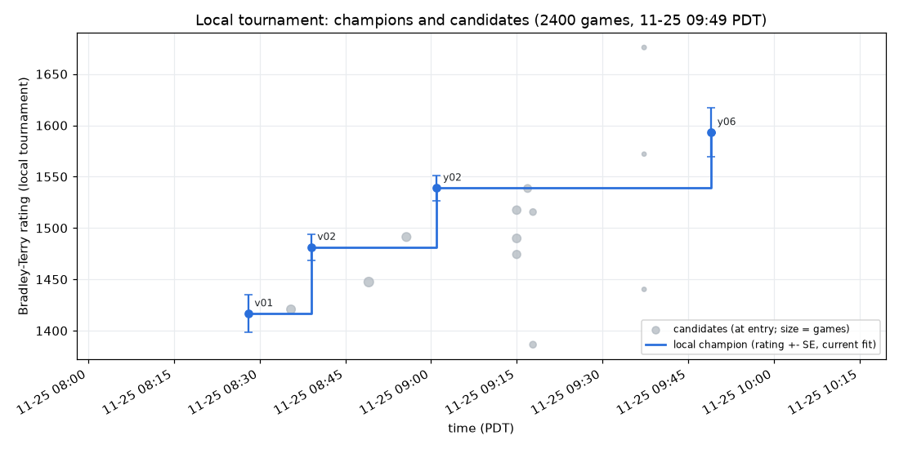

# Local tournament Elo

Bradley-Terry ratings of our own bots in the local tournament (`tools/tourney.py`), all 2400 games in one fit as of 2026-11-25 09:49 PDT, so every point is on the same scale; earlier champions are shown at their current rating. Regenerate with `tools/tourney.py chart`.

| Champion from (PDT) | Bot | Change on base | Submission | Rating +- SE | Games |
|---|---|---|---:|---:|---:|
| 2026-11-25 08:28 | v01 | foundation bot |  | 1417 +- 18 | 435 |
| 2026-11-25 08:39 | v02 | nav wall-follow fix + bytecode guards on v01 | #6 | 1481 +- 13 | 801 |
| 2026-11-25 09:01 | y02 | paint-heavy tower mix + paint towers upgraded first on v02 | #7 | 1539 +- 13 | 799 |
| 2026-11-25 09:49 | y06 | 3 opening soldiers instead of 2 on y02 | #35 | 1593 +- 24 | 223 |
